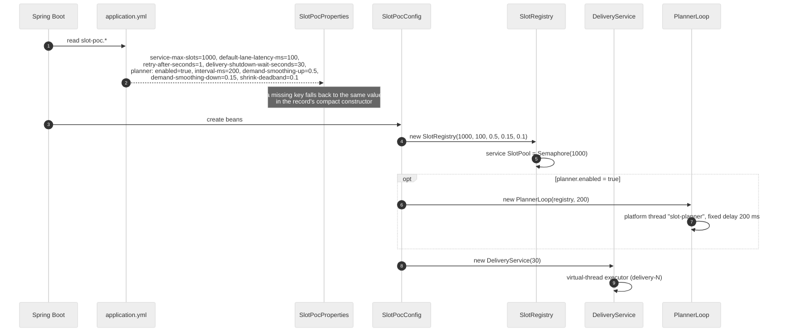
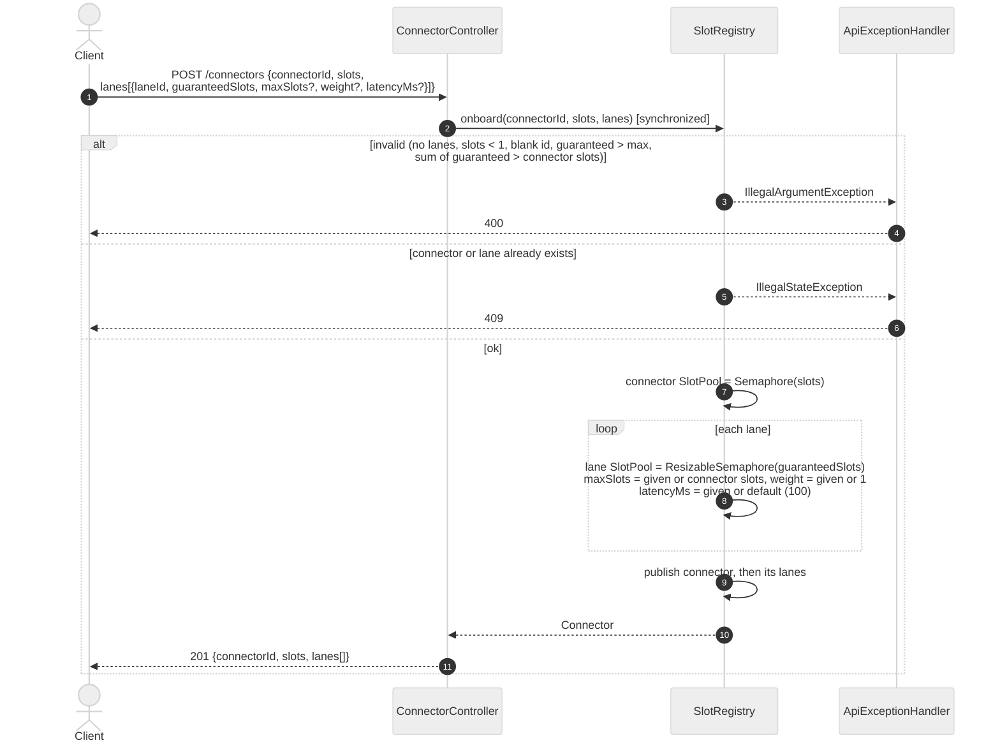
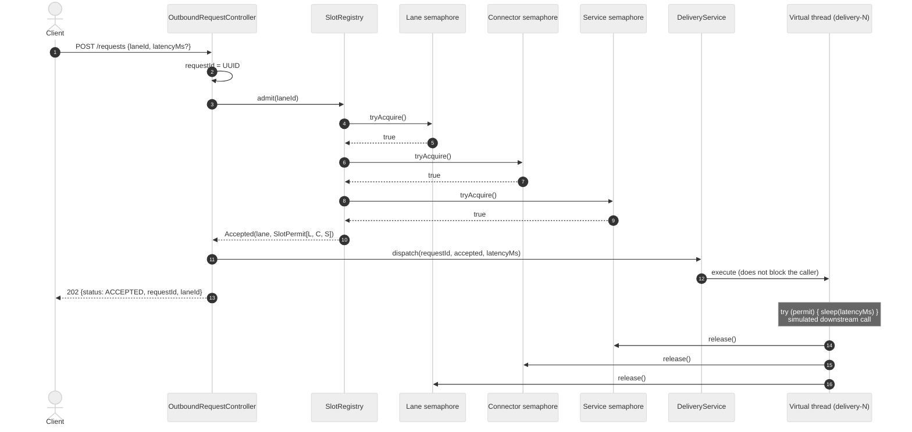
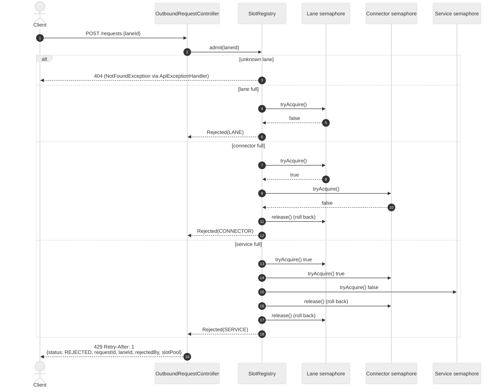
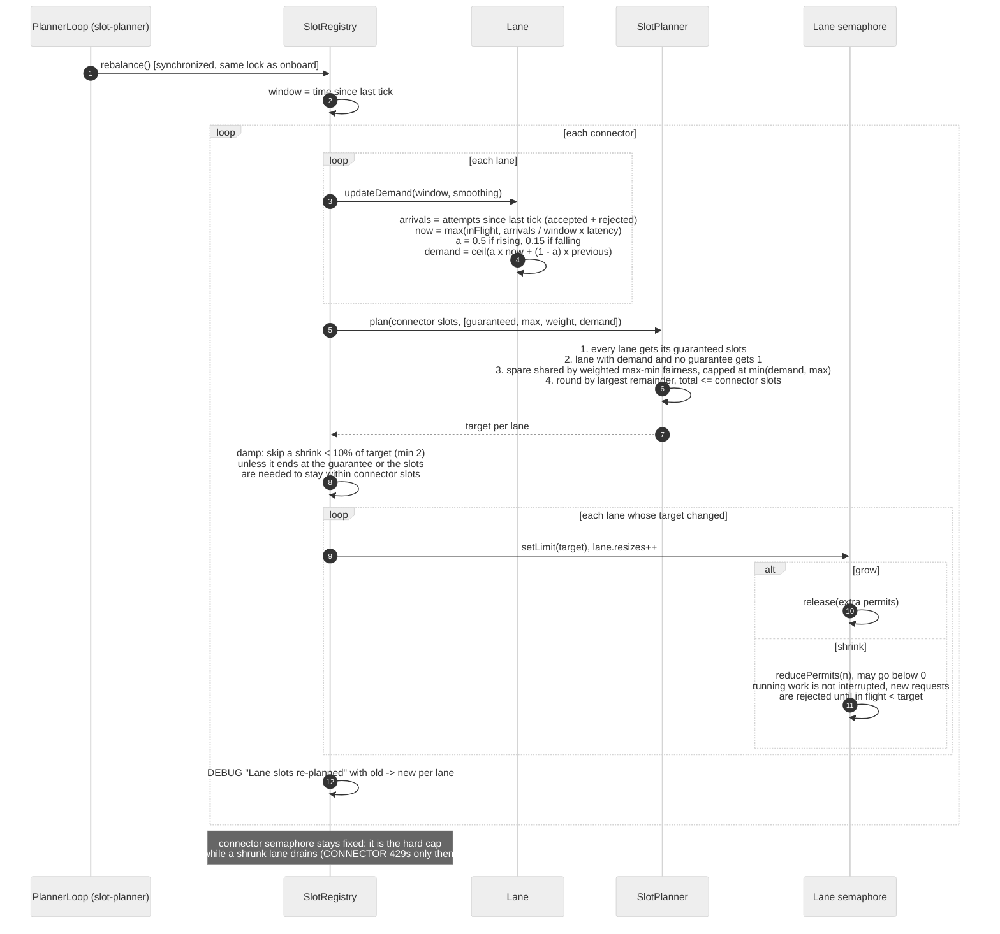
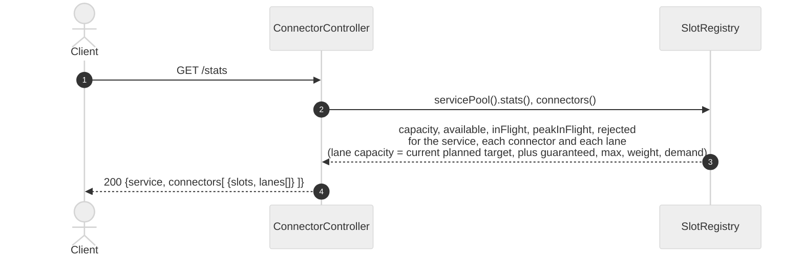

# Sequence diagrams: outbound-slot-poc

These diagrams are written in Mermaid. They render in IntelliJ (Markdown preview), on GitHub and at mermaid.live.

## 1. Startup: where the defaults come from

## 2. Onboard a connector: POST /api/v1/connectors

## 3. Submit a request: accepted path

## 4. Submit a request: rejected path (example: connector full)

## 5. Shared lane slots: planner tick every 200 ms

## 6. Read stats: GET /api/v1/stats and GET /api/v1/connectors/{id}

